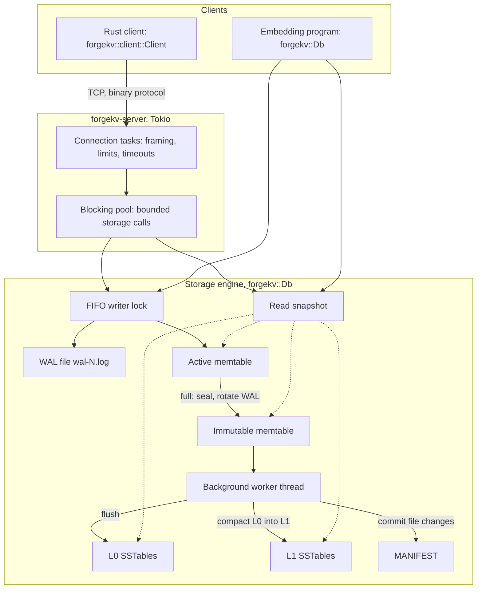
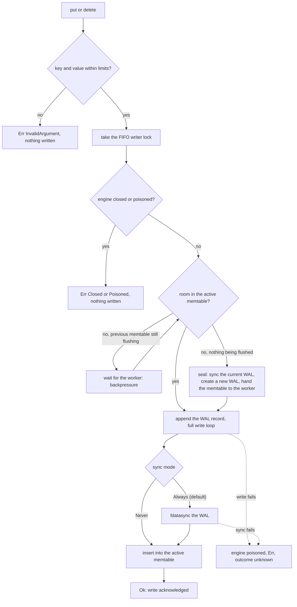
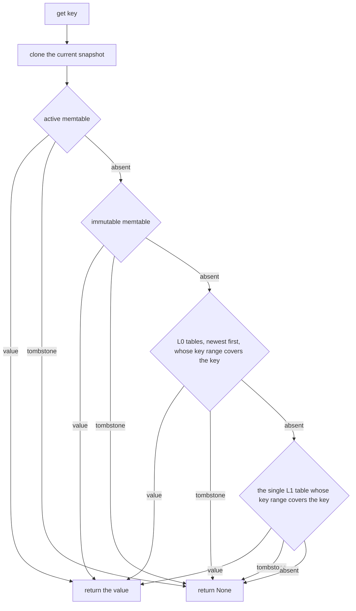
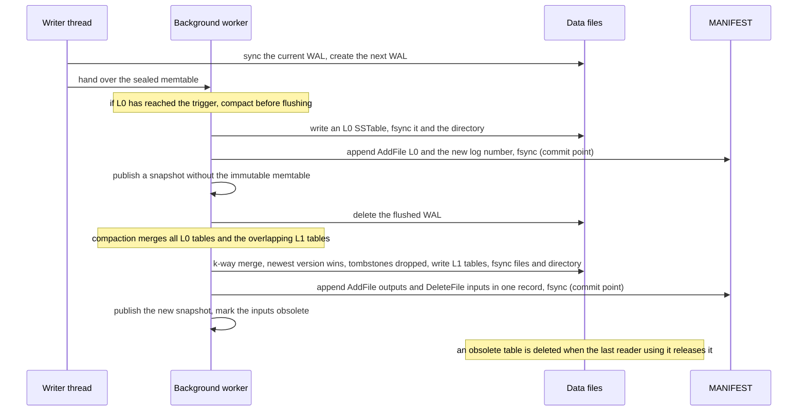
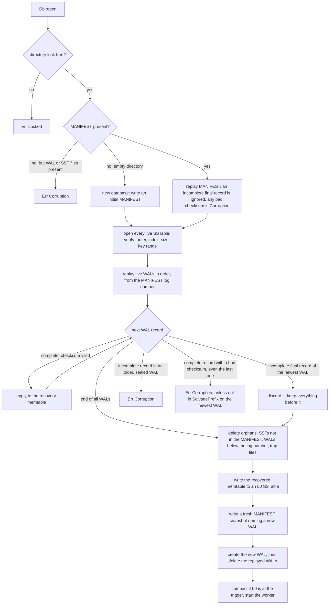
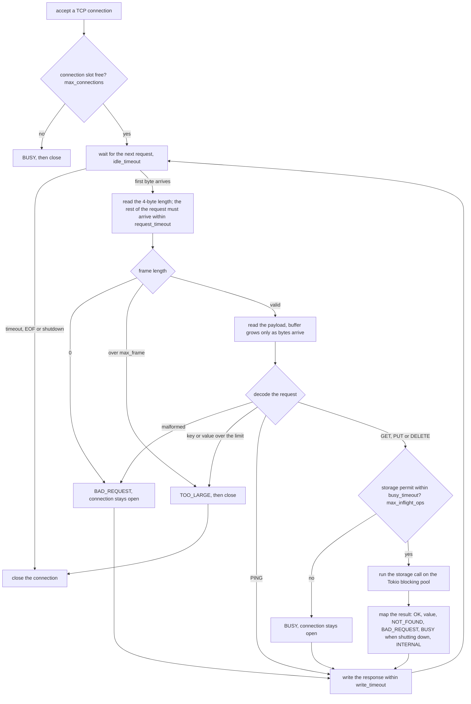

# ForgeKV

ForgeKV is an educational, persistent key-value storage engine written in
Rust. It implements a checksummed write-ahead log (WAL), an in-memory
memtable, immutable SSTables organised as a two-level LSM tree (L0 and L1),
background flush and compaction, crash recovery, and an asynchronous TCP
server built on Tokio. It is a single-node engine written to study storage
internals; it is not production software.


*Conceptual overview. The `forgekv-cli` binary and the Python/Go clients
shown in the diagram are illustrative and are not implemented. This
repository provides the `forgekv-server` binary, a Rust async client
(`forgekv::client::Client`), the `forgekv-bench` benchmark harness, and a
[documented binary protocol](docs/FORMATS.md#wire-protocol--srcprotocolrs)
that other clients could implement.*

## Features

- **Key-value API** (`forgekv::Db`): `put`, `get`, `delete`, plus explicit
  `flush`, `compact`, `shutdown` and `close`. A `Db` can be shared across
  threads (`Arc<Db>`).
- **Write-ahead log** with CRC-32/IEEE checksums on every record. Under the
  default `SyncMode::Always` a write is acknowledged only after `fdatasync`.
- **Memtable and SSTables:** a sorted in-memory memtable is flushed to
  immutable, block-indexed SSTables; deletes are tombstones.
- **Two-level compaction:** all of L0 plus the overlapping L1 tables are
  merged into L1 by a single background worker; tombstones are dropped at
  L1.
- **MANIFEST** as the source of truth for live files, with crash-safe
  commit ordering (file fsync, directory fsync, then manifest record).
- **Crash recovery** that discards an *incomplete* final WAL record but
  refuses to open on any *complete* record with a bad checksum.
- **Bounded memory and backpressure:** at most two memtables; writers wait
  when both are full. A FIFO writer lock bounds how long each writer waits.
- **Tokio TCP server** (`forgekv-server`) with a length-prefixed binary
  protocol, frame/key/value limits checked before allocation, connection
  and in-flight limits, idle/request/write timeouts, and graceful shutdown
  on SIGINT/SIGTERM.
- **Benchmark harness** (`forgekv-bench`) with exact latency percentiles
  and recorded environment metadata.
- **Fault-injection tests** (Cargo feature `failpoints`, test-only), SIGKILL
  tests, a whole-database corruption sweep and a stored format fixture.

## Requirements

- **Rust** with Cargo, edition 2024. Developed and tested with rustc
  1.98.1. The code uses `std::fs::File::try_lock`/`unlock`, stabilised in
  Rust 1.89, so older toolchains will not build it (versions between 1.89
  and 1.98.1 have not been tested).
- **A Unix-like OS.** The engine uses Unix-only APIs (`FileExt::read_at`,
  `flock`). Developed and tested on Linux (Ubuntu 26.04, kernel 7.0,
  x86_64, ext4).
- **For the test suite:** the `kill`, `sleep` and `true` programs on
  `PATH` (used by process-level tests).
- No external services. Runtime dependencies: `crc32fast`, `tokio`.

## Build and installation

ForgeKV is not published on crates.io. Build from a checkout:

```bash
cargo build --release
# binaries: target/release/forgekv-server, target/release/forgekv-bench
```

To install both binaries into Cargo's bin directory:

```bash
cargo install --path .
```

To use the library from another Rust project, depend on it by path (or by
git URL once the repository is published):

```toml
[dependencies]
forgekv = { path = "../forgekv" }
```

Embedded use:

```rust
use forgekv::{Db, Options};

fn main() -> forgekv::Result<()> {
    let db = Db::open("./data", Options::default())?; // SyncMode::Always by default
    db.put(b"user:1", b"alice")?;
    assert_eq!(db.get(b"user:1")?, Some(b"alice".to_vec()));
    db.delete(b"user:1")?;
    assert_eq!(db.get(b"user:1")?, None);
    db.close() // stops the background worker and syncs the WAL
}
```

`Options { sync_mode: SyncMode::Never, ..Options::default() }` selects the
faster, non-syncing mode (see [Durability](#durability-semantics)).

## Running the server

```bash
cargo run --release --bin forgekv-server -- --dir ./data
# prints: listening on 127.0.0.1:7878
```

| Flag | Default | Meaning |
|---|---|---|
| `--dir PATH` | (required) | Database directory (created if missing) |
| `--addr HOST:PORT` | `127.0.0.1:7878` | Listen address (port `0` picks a free port) |
| `--sync always\|never` | `always` | WAL sync mode |
| `--max-connections N` | 1024 | Connections beyond this get `BUSY` and are closed |
| `--max-inflight N` | 64 | Concurrent storage operations |
| `--idle-timeout-ms N` | 60000 | Close a connection idle between requests |
| `--request-timeout-ms N` | 10000 | Time allowed to receive the rest of a request |

Engine options use the defaults: keys up to 4 KiB, values up to 1 MiB,
4 MiB memtable. SIGINT or SIGTERM starts a graceful shutdown; a second
signal exits immediately (acknowledged writes are already in the WAL). An
unknown flag or `--help` prints the usage and exits with status 2.

## Using the client and protocol

**Rust client.** `forgekv::client::Client` is a minimal async client
(requires a Tokio runtime in the calling program):

```rust
use forgekv::client::Client;

#[tokio::main]
async fn main() -> Result<(), Box<dyn std::error::Error>> {
    let mut client = Client::connect("127.0.0.1:7878").await?;
    client.ping().await?;
    client.put(b"user:1", b"alice").await?;
    assert_eq!(client.get(b"user:1").await?, Some(b"alice".to_vec()));
    client.delete(b"user:1").await?;
    Ok(())
}
```

`Client::send` and `Client::recv` allow pipelining; responses arrive in
request order.

**Binary protocol.** Every message is a frame: a big-endian `u32` length
followed by the payload. Requests are `op u8` + body (1 PING, 2 GET,
3 PUT, 4 DELETE, with big-endian `u32` length-prefixed keys and values);
responses are `status u8` + body (0 OK, 1 NOT_FOUND, 2 BAD_REQUEST,
3 TOO_LARGE, 4 BUSY, 5 INTERNAL). The full specification is in
[`docs/FORMATS.md`](docs/FORMATS.md#wire-protocol--srcprotocolrs). For
example, with OpenBSD `nc` against a running server:

```bash
printf '\000\000\000\001\001' | nc -N 127.0.0.1 7878 | od -An -tx1
#  00 00 00 01 00                       PING -> OK
printf '\000\000\000\013\003\000\000\000\001k\000\000\000\001v' | nc -N 127.0.0.1 7878 | od -An -tx1
#  00 00 00 01 00                       PUT k=v -> OK
printf '\000\000\000\006\002\000\000\000\001k' | nc -N 127.0.0.1 7878 | od -An -tx1
#  00 00 00 06 00 00 00 00 01 76        GET k -> OK, value "v"
```

There is no command-line client.

## Running tests

```bash
scripts/check.sh                      # fmt check, clippy -D warnings (with and without
                                      # failpoints), all tests with and without failpoints
cargo test                            # tests without fault injection
cargo test --features failpoints      # adds the crash-point tests (tests/crash.rs and others)
mkdir -p target/ext4-tmp && TMPDIR=$PWD/target/ext4-tmp cargo test --all-features
                                      # on a real disk; /tmp is often tmpfs, where fsync is nearly free
```

The `failpoints` feature compiles in test-only fault injection; never
enable it in a build that stores real data.

## Running benchmarks

```bash
scripts/bench.sh                      # full matrix, ~25 min -> bench-results/<UTC timestamp>/
cargo run --release --bin forgekv-bench -- --mode engine --workload readwrite --read-pct 50 \
    --keys 200000 --threads 4 --sync always --runs 5 --warmup-secs 3 --duration-secs 10 \
    --dir bench-results/tmp --out bench-results/mine
```

Modes: `engine` (in-process), `server` (TCP, in-process server on
loopback), `recovery` (time of `Db::open`), `fsync` (device baseline).
`forgekv-bench --help` lists every flag. Each invocation writes one JSON
file per configuration with all raw per-run statistics and the
environment. Point `--dir` at a real disk; the harness warns when it is on
tmpfs. The recorded environment includes the absolute benchmark directory,
so review result files before publishing them.

## Architecture

### Storage architecture



Writers are serialized by a FIFO writer lock, so WAL order equals memtable
order and every writer waits only for writers that arrived earlier.
Readers clone a reference-counted snapshot of the active memtable, the
immutable memtable, L0 and L1, and read without holding any engine lock;
every state change replaces the snapshot as a whole, so data stays visible
while it moves between layers. One background thread performs all flushes
and compactions.

### Write path



- **`Always`**: the record is on stable storage (as far as the device
  honours `fdatasync`) before the call returns.
- **`Never`**: the call returns once the record is in the OS page cache.
  The WAL is still synced when a memtable is sealed and on `close`.
- A write that fails before logging was not applied. A failure while
  writing or syncing the WAL poisons the engine for writes, and the outcome
  is **unknown**: the record may be replayed by the next recovery.

### Read path



The first layer that has an entry for the key decides: a tombstone hides
every older version below it. An empty value is a value, distinct from a
deleted key. SSTable lookups binary-search the block index and read one
checksummed block; there is no Bloom filter or block cache, so reads rely
on the OS page cache.

### Flush and compaction



A new file is always durable (file and directory fsynced) before the
MANIFEST names it, and every version change is a single MANIFEST record.
The MANIFEST is rewritten as a one-record snapshot (temporary file, fsync,
rename, directory fsync) on every open and whenever it grows past
`Options::manifest_max_bytes`. The worker compacts whenever L0 reaches
`l0_compaction_trigger` (default 4), so L0 never exceeds the trigger.

### Recovery



Everything before the orphan deletion only reads, so a `Corruption` error
leaves the directory as it was found. Recovery never truncates a file: a
replayed WAL is retired and never appended to again. The directory lock is
an `flock` on `LOCK`, released explicitly when the `Db` is dropped (and by
the kernel if the process dies).

### Server request lifecycle



`max_frame` is `1 + 4 + max_key_len + 4 + max_value_len` bytes (1,052,681
with the defaults). Storage calls never run on Tokio's async worker
threads. **Graceful shutdown:** the listener is closed first, idle
connections close, a request already in progress completes and is
answered, connections still open after the grace period (5 s) are
aborted, and finally the engine is shut down (worker joined, WAL synced).

## On-disk format and integrity

The database directory holds `LOCK`, `MANIFEST`, `wal-N.log` files and
`N.sst` files. Formats are specified in [`docs/FORMATS.md`](docs/FORMATS.md):

- On disk, integers are little-endian and every checksum is
  **CRC-32/IEEE** (never CRC-32C). WAL and MANIFEST share one record-log
  format with a checksum over each record's length and another over its
  payload. SSTables checksum every data block, the index and the footer.
- Every byte of every file is covered by a checksum or validated: flipping
  one bit in every byte of a small database (2,078 bytes across MANIFEST,
  WAL, L0 and L1 SSTables) was detected every time, at open or on read.
  `tests/corruption.rs` runs the same sweep on every second byte.
- No length read from disk or the network is used to allocate memory
  before it has been checked against hard limits.
- Files carry format versions. `tests/golden.rs` checks that a stored
  database (`tests/data/golden-db/`) still opens with the expected
  contents and that the current code reproduces it byte for byte.

## Durability semantics

| | `SyncMode::Always` (default) | `SyncMode::Never` |
|---|---|---|
| A write is acknowledged after | its WAL record is written **and `fdatasync` succeeded** | its WAL record is written to the OS (no sync) |
| Process crash / `kill -9` | no acknowledged write lost (**tested**) | no acknowledged write lost (**tested**) |
| OS crash / power loss | designed to lose no acknowledged write if the device honours flushes (**not tested**) | recent acknowledged writes can be lost |

- **Process-crash tests do not establish power-loss durability.** A
  SIGKILL leaves the kernel's page cache intact. Durability against OS
  crash or power loss rests on the order of fsyncs, renames and directory
  fsyncs, which has been reviewed but not tested on real power loss; drives
  that ignore flush commands cannot be detected.
- `Never` is intended for benchmarks and data that can be recreated.
- A *complete* WAL or MANIFEST record with a bad checksum makes `open` fail
  with `Error::Corruption`, even when it is the last record; only an
  *incomplete* final record is treated as a torn write. The opt-in
  `RecoveryMode::SalvagePrefix` drops a damaged tail of the newest WAL and
  reports it.

## Benchmarks

Method, environment, every configuration and the caveats are in
[`docs/BENCHMARKS.md`](docs/BENCHMARKS.md). The harness records every
operation's latency (exact percentiles), runs each configuration 5 times
after a warm-up, and stores the raw results with the machine metadata and
a CRC-32 fingerprint of the source code.

| Session | Code measured | Use |
|---|---|---|
| [`bench-results/20261026T173115Z/`](bench-results/20261026T173115Z/summary.md) | Phase 8 source, `crc32:bbce3c06` | current results |
| [`bench-results/20261026T160449Z/`](bench-results/20261026T160449Z/summary.md) | Phase 7 source, `crc32:0f6f6c76` | historical, used for comparison |

The source in this repository (`crc32:446a43bc`) differs from the Phase 8
source by the directory-lock fix (`src/fs.rs`, plus a field type in
`src/engine.rs` and a doc comment in `src/error.rs`), which no benchmark
times, by the `license = "MIT"` metadata field in `Cargo.toml`, and by
documentation comments in `src/`; the last two do not affect runtime
behaviour. The current source has not been re-benchmarked.

Phase 8 session, one laptop (Intel i5-12500H, ext4 on NVMe, Linux 7.0),
16-byte keys, 100-byte values, 200,000 keys, medians with min–max across
5 runs:

| workload (engine, in-process) | `SyncMode::Always` | `SyncMode::Never` |
|---|---|---|
| random PUT, 1 thread | 306 ops/s (287–744), PUT p50 3.43 ms | 383,643 ops/s (381,304–407,399), PUT p50 932 ns |
| random PUT, 4 threads | 287 ops/s (249–306), worst single PUT 28.22 ms | 236,323 ops/s (185,663–242,003) |
| random GET, 4 threads (read-only) | 2,255,094 ops/s (1,948,064–2,325,036), GET p99 2.6 µs | (reads never sync) |
| 50% GET / 50% PUT, 4 threads | 529 ops/s (506–840) | 493,845 ops/s (471,098–521,487) |

- With `Always` each write waits for its own `fdatasync` (no group
  commit), so write throughput equals the device's sync rate, which on
  this machine varies between runs (about 0.6 ms or 3–4 ms per sync).
- With one writer at full speed under `Never`, writes were blocked 34–40%
  of the time waiting for room while the single background worker
  compacted (80% with 1000-byte values), measured with the engine's stall
  counters.
- Recovery replayed 300,000 WAL records (39.2 MiB) in about 313 ms. All
  datasets fit in RAM, so reads were served from the OS page cache.

These numbers describe one machine and these workloads only; they are not
a comparison with other databases.

## Testing and crash-recovery coverage

| Suite | Covers |
|---|---|
| unit tests in `src/` | record framing and CRCs (golden bytes, CRC known answer), partial and failing writes, WAL/MANIFEST encoding, memtable, merge, protocol decoding (including random bytes), FIFO lock, directory lock, benchmark statistics |
| `tests/engine.rs`, `tests/lsm.rs` | API semantics, reopen with data in WAL/SST/both, tombstones never resurrect, compaction invariants, randomized model tests |
| `tests/recovery.rs` | truncation at every offset, bit flips in mid-log and final records, salvage mode, simulated loss of unsynced WAL bytes |
| `tests/sstable.rs`, `tests/sstable_alloc.rs`, `tests/corruption.rs` | SSTable corruption sweeps, bounded allocation on malformed files, single-bit flips across a whole database |
| `tests/crash.rs` (feature `failpoints`) | an injected failure at each step of WAL rotation, flush, compaction, MANIFEST rewrite and open, then recovery against a model |
| `tests/kill.rs` | a writer process killed with SIGKILL at random moments during writes, flushes and compactions; every acknowledged write must survive |
| `tests/concurrency.rs` | concurrent readers and writers, no read gaps during flush or compaction, backpressure, shutdown, worker panics, stall counters |
| `tests/server.rs` | protocol over TCP, malformed and oversized input, limits and timeouts, connection floods, graceful shutdown, SIGKILL of the server binary with requests in flight |
| `tests/lock.rs` | directory-lock exclusivity across processes, release on close, exit and SIGKILL, reopening while other threads spawn processes |
| `tests/golden.rs` | on-disk format compatibility against `tests/data/golden-db/` |

All of these simulate **process** crashes. None of them is a power-loss
test.

## Limitations and out-of-scope features

Current limitations:

- No power-loss testing (see [Durability](#durability-semantics)).
- One background worker performs every flush and compaction; when it is
  busy and both memtables are full, all writers wait.
- Two-level compaction rewrites every overlapping L1 table, so write
  amplification grows with the dataset.
- No group commit: under `SyncMode::Always` each write pays its own fsync.
- The FIFO writer lock bounds waiting time but lowers throughput when
  several writers contend under `SyncMode::Never`.
- The server bounds memory per connection (about twice the maximum frame)
  and by `max_connections`, but has no global memory budget.
- After a crash, the directory lock is released by the kernel once no
  process holds a copy of its descriptor (normally immediately).
- No Bloom filters, block cache or compression; no range scans, batched
  writes or snapshots; no command-line client and no non-Rust client;
  single process; Unix only.

Explicitly out of scope: replication, consensus, transactions, SQL or any
query language, TTL, encryption, and Windows support.

## Repository layout

```
src/
  lib.rs              public API re-exports
  engine.rs           Db: write and read paths, recovery, background worker
  fairlock.rs         FIFO writer lock
  logfile.rs          record-log framing and CRCs (WAL and MANIFEST)
  wal.rs              WAL records and replay
  memtable.rs         sorted in-memory table with tombstones
  sstable/            SSTable format, builder and reader
  manifest.rs         version edits and the MANIFEST log
  version.rs          live tables per level, reference-counted tables
  merge.rs            k-way merge iterator
  compaction.rs       L0 -> L1 compaction
  fs.rs               file naming, directory fsync, directory lock
  config.rs           Options, SyncMode, RecoveryMode
  error.rs            Error type
  protocol.rs         wire protocol encoding and decoding
  server.rs           Tokio TCP server
  client.rs           async Rust client
  failpoint.rs        test-only fault injection (feature failpoints)
  codec.rs            bounds-checked reader used by the format parsers
  test_io.rs          I/O fault-injection helpers for unit tests
  bin/forgekv-server.rs   server binary
  bin/forgekv-bench/      benchmark harness
tests/                integration, recovery, crash, concurrency, server and lock tests
tests/data/golden-db/ on-disk format fixture
docs/FORMATS.md       on-disk and wire formats
docs/BENCHMARKS.md    benchmark method, results and provenance
bench-results/        recorded benchmark sessions
scripts/check.sh      formatting, lint and test gate
scripts/bench.sh      benchmark matrix
CLAUDE.md             project rules
```

## License

ForgeKV is licensed under the [MIT License](LICENSE).
